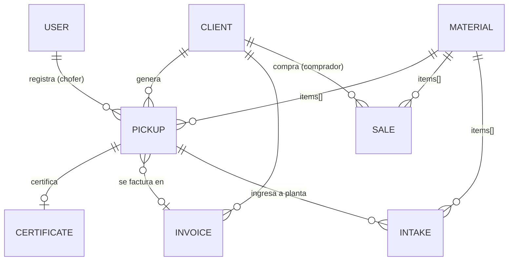

# 2. Modelo de datos (MongoDB)

Las listas cortas que siempre se leen junto al padre (materiales de un retiro, direcciones de un cliente, pagos de una factura) van **embebidas**. Las entidades con vida propia van en colecciones separadas y se referencian por `ObjectId`.

## Colecciones

### `users`
| Campo | Tipo | Notas |
|---|---|---|
| nombre, email | string | email único |
| passwordHash | string | bcrypt, nunca se devuelve |
| rol | enum | `admin`, `administracion`, `operador_planta`, `chofer` |
| activo | bool | |

### `clients` — generadores y compradores
| Campo | Tipo | Notas |
|---|---|---|
| tipo | enum | `generador`, `comprador`, `ambos` |
| razonSocial, cuit, condicionIva | | CUIT único, se guarda sin guiones |
| contacto | {nombre, email, telefono} | teléfono en formato WhatsApp (549343…) |
| direcciones[] | {alias, direccion, lat, lng} | un cliente puede tener varias sucursales |
| **tarifa** | {modalidad, montoFijo, preciosPorKg[]} | `por_retiro` · `por_kg` · `abono_mensual` · `sin_cargo`. `preciosPorKg` pisa la tarifa por defecto del material para este cliente |
| contrato | {numero, inicio, fin, frecuenciaRetiro, diasPagoFactura} | |
| activo | bool | baja lógica |

### `materials`
| Campo | Tipo | Notas |
|---|---|---|
| codigo | string | único, mayúsculas (`PET`, `CART`) |
| nombre, categoria | | |
| factorCo2 | number | kg CO2e evitados por kg recuperado |
| tarifaRetiroKg | number | $ por kg que se cobra al generador (default) |
| precioVentaKg | number | precio de referencia de venta |

> ⚠️ **Factores de CO2.** Los valores del seed son **de ejemplo**. Antes de entregar certificados reales hay que definir una fuente (p. ej. modelo WARM de la EPA, factores DEFRA del Reino Unido o un estudio local) y anotarla en el certificado. Es lo que le da credibilidad al documento ante auditorías de los clientes.

### `pickups` — retiros
| Campo | Tipo | Notas |
|---|---|---|
| numero | int | correlativo (colección `counters`) |
| localId | uuid | generado por la app; índice único → idempotencia |
| cliente, chofer | ref | |
| fecha, direccion, ubicacion{lat,lng} | | |
| items[] | {material, pesoEstimadoKg, pesoRealKg?} | |
| fotos[] | {url, subidaEn} | |
| estado | enum | `registrado` → `en_planta` · `anulado` |
| certificado, factura | ref \| null | `factura: null` = pendiente de facturar |

Índices: `{cliente:1, fecha:-1}`, `numero` único, `localId` único sparse.

### `intakes` — ingresos a planta
`{fecha, origen: retiro|recuperador|entrega_voluntaria|otro, retiro?, items[{material, pesoKg}]}`
Permite registrar material que no vino de un retiro propio (recuperadores, entregas voluntarias).

### `sales` — ventas
`{fecha, comprador→Client, remito, items[{material, pesoKg, precioKg}], total (calculado), cobrada}`

### `certificates`
| Campo | Notas |
|---|---|
| codigo | aleatorio, único — va en el QR |
| numero | correlativo |
| retiro | único: un certificado por retiro |
| clienteSnapshot | razón social y CUIT **al momento de emitir** |
| materiales[] | {nombre, pesoKg, pesoEstimado, co2EvitadoKg} — snapshot |
| totalKg, co2EvitadoKg | |
| envios[] | {canal, destino, fecha} — trazabilidad de a quién se mandó |
| anulado | la página pública muestra "anulado" |

### `invoices` — liquidaciones / prefacturas
| Campo | Notas |
|---|---|
| numero, cliente, clienteSnapshot | |
| periodo {desde, hasta} | |
| retiros[] | los retiros incluidos (y cada retiro apunta a esta factura) |
| lineas[] | {descripcion, cantidad, unidad, precioUnitario, subtotal} |
| total, emitidaEn, vencimiento | vencimiento = emisión + `contrato.diasPagoFactura` |
| estado | `pendiente` · `pagada` · `anulada` |
| pagos[] | {fecha, monto, medio, referencia} — admite pagos parciales |
| comprobanteFiscal | {tipo, puntoVenta, numero, cae} — se completa al emitir la factura en ARCA |
| *virtuales* | `saldo`, `vencida` (se calculan, no se guardan) |

### `counters`
`{_id: 'retiro' | 'certificado' | 'factura', seq}` — numeración correlativa atómica.

## Reglas de facturación

| Modalidad | Cálculo |
|---|---|
| `por_retiro` | cantidad de retiros del período × `montoFijo` |
| `por_kg` | Σ kg por material × (precio del cliente ‖ `tarifaRetiroKg` del material) |
| `abono_mensual` | `montoFijo` |
| `sin_cargo` | no se factura (p. ej. clientes que solo entregan material valioso) |

Solo entran retiros no anulados y con `factura: null`. Anular una factura libera sus retiros.

---

## Multi-organización (plataforma)

### `organizations`
| Campo | Notas |
|---|---|
| tipo | `cooperativa` (presta el servicio), `empresa` o `municipio` (clientes generadores con portal) |
| nombre, cuit | CUIT único en la plataforma; sirve para vincular un mismo cliente entre cooperativas |
| habilitaciones | Solo cooperativas: `corrientes` que puede gestionar (por defecto `rsu`) y `registros` (inscripciones, por ejemplo como operador de peligrosos, con vencimiento) |

### Aislamiento por cooperativa
- Clientes, materiales, retiros, ingresos, ventas, movimientos, certificados y facturas llevan **`coop`**. `lib/tenancy.js` lo completa y filtra automáticamente en cada consulta, según la cooperativa del usuario. **Una consulta sin cooperativa en contexto falla.**
- Los índices únicos son por cooperativa: `{coop, codigo}` en materiales, `{coop, cuit}` en clientes y `{coop, numero}` en retiros, certificados y facturas. La numeración también es propia de cada cooperativa.
- `Client.organizacion`: vincula el cliente con su organización (empresa o municipio) para el portal. Una empresa atendida por dos cooperativas tiene dos `Client` y una sola organización.
- `User.organizacion` + `rol`. Roles de cooperativa: `admin`, `administracion`, `operador_planta`, `chofer`. Roles de cliente: `cliente_admin`, `cliente`.

## Clasificación de residuos (ver [08-marco-normativo.md](08-marco-normativo.md))

`materials` suma:
| Campo | Valores |
|---|---|
| corriente | `rsu`, `regu`, `peligroso`, `industrial`, `fitosanitario` |
| fraccion | Solo RSU, Decreto 779/22 Anexo II: `secos_valorizables`, `basura`, `organicos`, `plasticos`, `papel_carton`, `vidrio`, `metales`. Si no se indica, se toma de la categoría |
| subtipoRegu | Solo REGU: `pilas_baterias`, `raee`, `lamparas`, `neumaticos`, `aceite_vegetal_usado`, `otros` |
| valorizable | `false` = va a disposición final (la fracción `basura` lo es siempre) |

## `movimientos`: libro de planta (solo agregado)
| Campo | Notas |
|---|---|
| tipo | `ingreso` (+), `venta` (−, destino valorización), `rechazo` (−, destino disposición final), `ajuste` (±) |
| material, kg | kg con signo |
| etapa | Etapa de la Ley 25.916 |
| ref | retiro, ingreso o venta de origen |

- Se escriben solos: al **pesar un retiro** (crea su ingreso; corregir o anular genera ajustes), al dar de alta un **ingreso** de terceros o una **venta**, y con **rechazos** y **ajustes** manuales.
- **No se editan ni se borran** (el modelo lo impide). Por eso los ingresos y las ventas tampoco se borran ni cambian sus kilos.
- Un rechazo se descuenta del material que se rechaza (por ejemplo, cartón húmedo).
- Stock por material = Σ kg. **Tasa de desvío** = valorizado ÷ (valorizado + dispuesto).

## Cambios en certificados y facturas
- `certificates.emisorSnapshot`: la cooperativa que certifica. `materiales[]` suma `corriente`, `fraccion` y `valorizable`.
- `invoices.detalle[]`: `{retiro, numero, fecha, sede, kg, importe}` para cada retiro incluido. El cliente lo ve en su portal (`importe` vacío = abono mensual).
