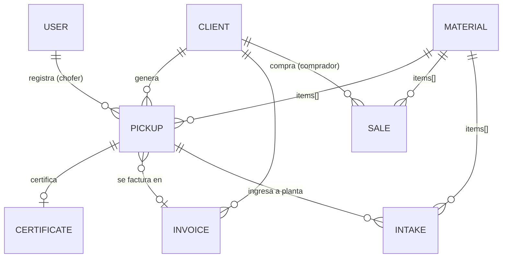

# 2. Modelo de datos (MongoDB)

Las listas cortas que siempre se leen junto al padre (materiales de un retiro, direcciones de un cliente, pagos de una factura) van **embebidas**. Las entidades con vida propia van en colecciones separadas y se referencian por `ObjectId`.

## Colecciones

### `users`
| Campo | Tipo | Notas |
|---|---|---|
| nombre, email | string | email único |
| passwordHash | string | bcrypt, nunca se devuelve |
| rol | enum | `admin`, `administracion`, `operador_planta`, `chofer` |
| activo | bool | |

### `clients` — generadores y compradores
| Campo | Tipo | Notas |
|---|---|---|
| tipo | enum | `generador`, `comprador`, `ambos` |
| razonSocial, cuit, condicionIva | | CUIT único, se guarda sin guiones |
| contacto | {nombre, email, telefono} | teléfono en formato WhatsApp (549343…) |
| direcciones[] | {alias, direccion, lat, lng} | un cliente puede tener varias sucursales |
| **tarifa** | {modalidad, montoFijo, preciosPorKg[]} | `por_retiro` · `por_kg` · `abono_mensual` · `sin_cargo`. `preciosPorKg` pisa la tarifa por defecto del material para este cliente |
| contrato | {numero, inicio, fin, frecuenciaRetiro, diasPagoFactura} | |
| activo | bool | baja lógica |

### `materials`
| Campo | Tipo | Notas |
|---|---|---|
| codigo | string | único, mayúsculas (`PET`, `CART`) |
| nombre, categoria | | |
| factorCo2 | number | kg CO2e evitados por kg recuperado |
| tarifaRetiroKg | number | $ por kg que se cobra al generador (default) |
| precioVentaKg | number | precio de referencia de venta |

> ⚠️ **Factores de CO2.** Los valores del seed son **de ejemplo**. Antes de entregar certificados reales hay que definir una fuente (p. ej. modelo WARM de la EPA, factores DEFRA del Reino Unido o un estudio local) y anotarla en el certificado. Es lo que le da credibilidad al documento ante auditorías de los clientes.

### `pickups` — retiros
| Campo | Tipo | Notas |
|---|---|---|
| numero | int | correlativo (colección `counters`) |
| localId | uuid | generado por la app; índice único → idempotencia |
| cliente, chofer | ref | |
| fecha, direccion, ubicacion{lat,lng} | | |
| items[] | {material, pesoEstimadoKg, pesoRealKg?} | |
| fotos[] | {url, subidaEn} | |
| estado | enum | `registrado` → `en_planta` · `anulado` |
| certificado, factura | ref \| null | `factura: null` = pendiente de facturar |

Índices: `{cliente:1, fecha:-1}`, `numero` único, `localId` único sparse.

### `intakes` — ingresos a planta
`{fecha, origen: retiro|recuperador|entrega_voluntaria|otro, retiro?, items[{material, pesoKg}]}`
Permite registrar material que no vino de un retiro propio (recuperadores, entregas voluntarias).

### `sales` — ventas
`{fecha, comprador→Client, remito, items[{material, pesoKg, precioKg}], total (calculado), cobrada}`

### `certificates`
| Campo | Notas |
|---|---|
| codigo | aleatorio, único — va en el QR |
| numero | correlativo |
| retiro | único: un certificado por retiro |
| clienteSnapshot | razón social y CUIT **al momento de emitir** |
| materiales[] | {nombre, pesoKg, pesoEstimado, co2EvitadoKg} — snapshot |
| totalKg, co2EvitadoKg | |
| envios[] | {canal, destino, fecha} — trazabilidad de a quién se mandó |
| anulado | la página pública muestra "anulado" |

### `invoices` — liquidaciones / prefacturas
| Campo | Notas |
|---|---|
| numero, cliente, clienteSnapshot | |
| periodo {desde, hasta} | |
| retiros[] | los retiros incluidos (y cada retiro apunta a esta factura) |
| lineas[] | {descripcion, cantidad, unidad, precioUnitario, subtotal} |
| total, emitidaEn, vencimiento | vencimiento = emisión + `contrato.diasPagoFactura` |
| estado | `pendiente` · `pagada` · `anulada` |
| pagos[] | {fecha, monto, medio, referencia} — admite pagos parciales |
| comprobanteFiscal | {tipo, puntoVenta, numero, cae} — se completa al emitir la factura en ARCA |
| *virtuales* | `saldo`, `vencida` (se calculan, no se guardan) |

### `counters`
`{_id: 'retiro' | 'certificado' | 'factura', seq}` — numeración correlativa atómica.

## Reglas de facturación

| Modalidad | Cálculo |
|---|---|
| `por_retiro` | cantidad de retiros del período × `montoFijo` |
| `por_kg` | Σ kg por material × (precio del cliente ‖ `tarifaRetiroKg` del material) |
| `abono_mensual` | `montoFijo` |
| `sin_cargo` | no se factura (p. ej. clientes que solo entregan material valioso) |

Solo entran retiros no anulados y con `factura: null`. Anular una factura libera sus retiros.
